# Koverr MVP handover

Updated 18 November 2026. Continue on the existing `MVP` branch. See the [PRD](../docs/03-prd-mvp.md), [architecture](../docs/05-architecture.md), [build plan](../docs/07-validation-and-build-plan.md) and [design direction](../docs/08-design-direction.md).

## Start here in the next session

- The private cloud preview shows the sample workflow. The next step is to deploy and test the private pilot. Use the [deployment instructions](deploy/live-pilot.md).
- The Supabase project `koverr_privacy_agent_alpha` (`xehicmrxtxbabgxbabll`) is in West EU (Ireland). The signed-in Chrome dashboard shows the 11 Koverr tables. The available Management API token returned HTTP 403.
- Supabase Auth has email confirmation on. The email code length is six digits and the expiry is 600 seconds. The dashboard requires custom SMTP to change the default sign-in link to a code.
- **Follow-up task.** Configure Brevo Free in Supabase. Set `{{ .Token }}` in the Confirm sign up and Magic link or OTP templates. Verify delivery and sign-in with one test mailbox before you invite pilot users.
- The live test also needs an HTTPS Node 24 host, a replacement Supabase server key, and a production Have I Been Pwned key. Put these keys in the host's secret store.
- The live mailbox test, real roster import, and invited pilot are pending. Use one mailbox that you control for the live test. Get the reconciled SQLite backup from the landing-site operator after that test passes.

## MVP development

- The free check verifies an email address. It shows known breaches and gives the user steps to correct problems.
- The browser checks passwords. The user can export or delete account data.
- Cleanup lets the user review saved sites and request closure drafts. A founder can review these drafts.
- The deployment script checks the health route and the invite-only form. It uses the public HTTPS address.
- The roster export saves six fields to a new private SQLite file. It omits follow-up tokens. The verification script compares this file with Supabase and gives counts.
- The cohort report excludes the controlled test mailbox marker. It shows whether the cohort met each of the three G1 targets.



[Mermaid source](diagrams/mvp-development.mmd) · [Editable Excalidraw file](diagrams/mvp-development.excalidraw) · [PNG](diagrams/mvp-development.png)

## Built

- The implementation lives in `MVP/`. A small Astro integration mounts the free check, password checker, browser-only inventory and Cleanup workspace in the existing project, using the shared shell and design tokens.
- Sample mode uses five fictional breaches. Done, skip and undo use a short-lived sample cookie that is cleared when the user exits.
- The live free check sends a six-digit Supabase email code. Only a session with a confirmed email can reserve a scan. The lookup address comes from Supabase Auth, and the browser cannot supply a different address to scan.
- The Have I Been Pwned adapter distinguishes a clean response from provider failures. It stores breach metadata and ranks the next three fixes from a versioned Stolen playbook.
- Postgres stores the scan snapshot and fix outcomes. Row-level security scopes reads to the account owner. Only the server writes these tables. The database limits verification requests to five per address per rolling hour and prevents overlapping scans.
- The password checker uses Web Crypto in the browser. It requests a padded range with only the first five hash characters, matches the suffix on-device and keeps no history.
- Cleanup pilot accounts can explicitly save registrable domains and review choices. The app matches domains against saved breach metadata when available. An aggregate research query surfaces unknown domains without account identifiers.
- The browser-local inventory imports CSV or accepts manual domains, deduplicates registrable sites, and records Keep, Close or Not sure in memory. Close reveals the next step and an official guide for the starter directory. Reloading clears the list. Nothing is uploaded.
- Verified Cleanup pilot users can grant or withdraw versioned permission to prepare closure drafts. Changes are audited and included in account export. The agreement covers draft preparation only.
- Each of the top three breach plans asks whether the account is still used. Choosing no shows steps for closing it with the provider. Answers are editable, exported and deleted with the account.
- Customers can queue one active closure draft per saved website marked Close when an official guide is known. An allowlisted founder can review or decline the fixed template and log minutes. Reviewers see an email placeholder. Permission withdrawal or changing the Close decision cancels active drafts while retaining the review outcome.
- The invited free pilot gates OTP, verification and scans by invitation status. An aggregate report measures the invited cohort by signup variant, region and concern. No cohort has been invited yet.
- The launch-list migration validates SQLite backups in dry-run mode and copies consent and survey answers into a restricted Supabase roster. The real list has not been imported.
- The E3 pricing survey records a first choice after viewing results. The internal [free-check funnel query](supabase/reports/free-check-funnel.sql) reports completed checks, seven-day activation and paid intent. Sample choices stay local and are excluded.
- Account controls provide a JSON export and hard deletion of the active account. Foreign keys cascade deletion to saved results and progress. The app has its own privacy notice.

## Run the sample

Use Node 24 or newer. From the repository root, run `npm ci` if dependencies are missing, then `npm run dev`. Open `/app/` or go directly to `/app/?sample=1`. The sample needs no provider credentials. The separate password checker uses the public Pwned Passwords range API and needs no sign-in.

## Hosted sample preview

[Open the private cloud preview](https://koverr-mvp-preview.kondrat-adrian.chatgpt.site). Sign in to ChatGPT with the account that owns the Site if prompted. The cloud build uses the same sample findings, playbook, styling and password checker as the application. Sample progress, closure answers and the sample pricing choice stay in the browser tab and clear when you exit the sample. The separate inventory screen also runs locally in the browser. The Cleanup walkthrough lets you enable sample permission, queue a fictional draft, simulate founder review and withdraw permission. The preview has no email signup or personal breach lookup.

The static preview source is in `MVP/preview/`. Build it from the repository root with `node node_modules/astro/bin/astro.mjs build --config MVP/preview/astro.config.mjs --outDir dist/preview`. ChatGPT Sites project ID is `appgprj_6af5c87a174881919bfe32be11ec951d`. Reuse that private Site and its source checkout for future updates. The deployment includes only the preview source and shared files it imports.

## Connect a private live preview

See the [live deployment runbook](deploy/live-pilot.md) for the Node container, runtime settings and deployed acceptance checks.

1. For a fresh database, apply the SQL migrations in [supabase/migrations](supabase/migrations) in timestamp order to a UK or EU Supabase project. The dedicated pilot project already has all eight migrations. Configure transactional SMTP for the preview and put `{{ .Token }}` in the sign-up confirmation and sign-in email templates. Use a six-digit code and a ten-minute expiry. Review provider-side abuse limits and require confirmation for email sign-ins.
2. Copy [the environment template](.env.example) to `MVP/.env` and fill in the exact app origin, Supabase URL and keys, and a Have I Been Pwned key that supports breached-account lookups. Keep the service-role and breach-index keys on the server. The live form is available only at the configured origin.
3. Run `node --env-file=MVP/.env node_modules/astro/bin/astro.mjs dev --host 127.0.0.1 --port 4327`. Open `http://127.0.0.1:4327/app/`. For hosted builds, set `KOVERR_APP_ORIGIN` at build time as well as runtime so Astro can recognise the origin behind a proxy.
4. Use a mailbox you control to verify code delivery, scan, complete a step, sign in again to confirm persistence, export and delete. Check that the account and saved rows are gone. Provider reference: [Supabase email OTP](https://supabase.com/docs/guides/auth/auth-email-passwordless) and [Have I Been Pwned API](https://haveibeenpwned.com/API/V3).

### Enable Cleanup pilot access

After the user has verified their email in the private live preview, use their Supabase Auth user UUID to grant time-limited access in the Supabase SQL editor. Replace the example value with the intended pilot's UUID.

```sql
insert into public.koverr_cleanup_access (user_id, expires_at)
values ('<verified-user-uuid>', now() + interval '90 days')
on conflict (user_id) do update set expires_at = excluded.expires_at;
```

Set `KOVERR_CONCIERGE_REVIEWER_IDS` to comma-separated Supabase Auth user UUIDs for the founder review route. Use a separate reviewer identity when testing the customer flow. The queue is at `/app/cleanup/review/`. Inspect unresolved domains there and add verified official guides to `MVP/data/closure-directory.json`.

The first live version uses a separate Run breach check action after verification. It sends the address directly to Have I Been Pwned and stores one successful scan per free account. Sessions expire within an hour and can be renewed by signing in with a new code.

## Verification

```sh
node --test MVP/test/*.test.ts
npm run check
npm run build
```

All 27 automated tests passed. Astro diagnostics and the server build passed. The Docker container passed its health check and showed the invite-only form behind simulated HTTPS proxy headers. The roster export and import dry run passed with test data. Embedded Postgres tests passed for roster access, email code counter expiry, and the cohort report. The [live checks](deploy/live-pilot.md) need the HTTPS host and provider settings.

The built route passed a headless Chromium walkthrough using test providers. The test covered a wrong code, verification, scan, completion, undo, export, and deletion. The database tests also covered scan retries, account isolation, pricing choices, Cleanup access, draft withdrawal, and cascading deletion. Have I Been Pwned returned a result for its documented test account. In a mobile browser, the password checker sent only the five-character prefix to the password service.

## Next three milestones

1. **Deploy and test the private pilot.** Connect Brevo Free to Supabase. Set both email code templates. Set up the HTTPS host and add the server keys. Use one test mailbox to check code delivery, sign-in, breach lookup, export, and account deletion.
2. **Import and verify the roster.** After the mailbox test passes, export the reconciled roster from the landing host. Run the import and verify the records. Schedule the email code counter cleanup. Confirm that the job succeeds.
3. **Run the invited pilot.** Send the pilot invitations. Supabase sends the sign-in codes through Brevo. Measure completed checks, first fixes in seven days, and paid intent. Compare the results with G1 before you expand signup.

Use the [build plan](../docs/07-validation-and-build-plan.md) for the paid Cleanup work after G1. Expand the directory of official guides. Get legal review of sending authority and templates before you add relay sending.
