# Koverr MVP workflow and blocker guide

Status checked on 24 November 2026. The invite-only app is live. The cohort report recorded zero participants and zero audits. The pilot targets **£0 in additional service charges**. An existing domain, founder time, and any applicable registration fee are separate costs. [Current handover](handover.md) · [Development plan](../docs/07-validation-and-build-plan.md)

**First action** — Approve one test mailbox that you control. Use the existing Cloudflare Worker, Supabase project, and Resend setup. Start with a mailbox test before you change any service.



[Mermaid source](diagrams/mvp-workflow.mmd) · [Editable Excalidraw file](diagrams/mvp-workflow.excalidraw) · [PNG](diagrams/mvp-workflow.png)

## Done

| Area | Result |
| --- | --- |
| Landing page and waitlist | The existing site collects launch-list signups. The live audit has its own address. Keep the waitlist for visitors who do not have an invitation. |
| Deployment | The `MVP` branch deploys the invite-only app. The live Supabase gate rejected a fictional uninvited address. The fictional breach sample still works. |
| UK audit | The quick audit covers 192.com and ukphonebook.com. The deeper route adds Google Search. The user can record a match, no matches in the checked source, or a coverage gap. |
| Removal and progress | The app has five official routes. The user approves a match, submits their own request, and records replies, follow-ups, and rechecks. Experian and open-register opt-outs are optional. |
| Data controls and report | The app supports export and deletion. The audit expires after 90 days. The first expiry job succeeded. The cohort report records counts and time totals. |
| Verification | 35 automated tests passed. The compiled Worker passed sign-in, audit writes, export, and deletion with synthetic accounts. Live email delivery still needs a test mailbox. |

A user can also use the free password checker. The pilot makes zero paid search calls. [Live audit](https://koverr-mvp.uceiond.workers.dev/app/audit/) · [Fictional sample](https://koverr-mvp.uceiond.workers.dev/app/?sample=1) · [Verified source routes](pilot-preparation.md)

## To do now

One participant address is on the private shortlist. The landing copy is ready. See the [pilot readiness review](pilot-readiness.md) for the remaining approvals and the dashboard results.

### Approve the test mailbox

1. Choose one email address that you control and can open during the test. Use an address reserved for testing if possible.
2. Authorize adding that address to the Koverr test roster and requesting a sign-in code.
3. Keep the inbox open for the test. Enter the code on the Koverr page. Keep the code out of chat.

**Cost** — £0 with your existing mailbox. You can approve the test before you choose pilot participants.

### Approve participants and invitations

1. Choose a small group of consenting UK participants. Three to five people is a starting size for the first assisted sessions.
2. Get permission to use their email addresses for this pilot. Record the approved addresses and planned send window in a private list.
3. Approve the invitation draft and its recipients. If you want the agent to send it, authorize the send.
4. Choose the session format. Use your existing calendar or arrange the time by email.

**Cost** — £0 in new services. Send the invitations from your existing mailbox. Use Resend for sign-in codes. [Invitation draft and session instructions](pilot-preparation.md)

### Check pilot limits and privacy

1. Check the current plan and usage in Cloudflare, Supabase, and Resend. Check the Supabase project status before each pilot session.
2. Check the current Auth email limit in Supabase under **Authentication → Rate Limits**. Space sessions and retries below that limit and the Resend limit.
3. Check that the published privacy notice names the right contact and describes the data, recipients, and 90-day audit expiry. Check the ICO fee with its free self-assessment. If a fee applies, follow the ICO result. The ICO lists £52 for tier 1 and a £5 discount for Direct Debit. [Privacy notice](https://koverr-mvp.uceiond.workers.dev/app/privacy/) · [ICO fee self-assessment](https://ico.org.uk/for-organisations/data-protection-fee/data-protection-fee-self-assessment/) · [ICO fee guide](https://ico.org.uk/for-organisations/data-protection-fee/data-protection-fee)

### Draft the landing page update

The [landing page draft](landing-pilot-draft.md) is ready for review.

1. Describe a free assisted UK exposure audit. State the source limits.
2. Keep the early-access signup for general visitors. Give the direct audit link to approved participants.
3. Prepare the revised call to action for the next group. Publish the wider change after you approve the next group.

**Cost** — £0 in new services. Use the existing landing site. [Landing page repository instructions](../README.md)

## Blocked work

The items in the last column use the same names as the diagram. Start with the first named item that is still open.

| Blocked item | Reason | Item that unblocks it |
| --- | --- | --- |
| Verify live sign-in and data controls | The live test needs one approved mailbox. | [Approve the test mailbox](#approve-the-test-mailbox) |
| Run the assisted pilot | The sessions need verified sign-in, approved recipients, and pilot operating checks. | [Verify live sign-in and data controls](#verify-live-sign-in-and-data-controls) · [Approve participants and invitations](#approve-participants-and-invitations) · [Check pilot limits and privacy](#check-pilot-limits-and-privacy) |
| Review the pilot evidence | The report has no participant results. | [Run the assisted pilot](#run-the-assisted-pilot) |
| Open the next group | The first evidence review must support expansion. The draft needs approval before publication. | [Review the pilot evidence](#review-the-pilot-evidence) · [Approve the landing page draft](landing-pilot-draft.md) |
| Test paid assisted Cleanup | The pilot must show useful outcomes and demand for help. | [Review the pilot evidence](#review-the-pilot-evidence) |
| Add automation and self-service | Reliable results, repeated work, and sustainable founder time are still unproven. | [Test paid assisted Cleanup](#test-paid-assisted-cleanup) |
| Test recurring checks for Watch | The pilot has no evidence that rechecks provide recurring value. | [Review the pilot evidence](#review-the-pilot-evidence) |

If the first live test fails to deliver a code, [Restore sign-in email](#restore-sign-in-email) unblocks that retry. Do this only if the existing SMTP setup needs repair.

## How to complete each stage

### Verify live sign-in and data controls

**Owner action** — Approve the address and request. Open the inbox and enter the code on Koverr.

1. Open the existing Supabase project. In **SQL Editor**, add the approved address as a controlled test invite. Replace the example address in this query. Use a lowercase address.

```sql
insert into public.koverr_launch_list
  (email, variant, consent_version, joined_at, invited_at)
values
  ('controlled-test@example.test', 'breach', 'controlled-test', now(), now())
on conflict (email) do nothing;
```

2. If the insert adds no row, check whether the address already has an active invitation. Use a separate test address if you need a disposable account.
3. Open the live audit. Request one code. Check that an incorrect code fails. Enter the code from the inbox.
4. Save one test audit. Export the data and confirm that the audit appears. Use the account deletion control on the disposable test account. Verify that Supabase removed the audit row.
5. Remove the controlled roster entry after the test. Keep only the test result. Enter only information you control.

```sql
delete from public.koverr_launch_list
where email = 'controlled-test@example.test'
  and consent_version = 'controlled-test';
```

Use a second approved test address if you need to verify live account isolation. Confirm that the second export contains only that account's data.

The cohort report excludes the `controlled-test` marker. [Deployment acceptance instructions](deploy/live-pilot.md) · [Live audit](https://koverr-mvp.uceiond.workers.dev/app/audit/)

### Restore sign-in email

If the code does not arrive, check spam, Supabase Auth logs, and **Resend → Emails**. Check whether Supabase attempted to send it. Check whether Resend shows a delivery, rejection, or bounce.

If Resend needs a verified sending domain, use a domain that you already own. A sending subdomain such as `auth.your-domain.example` keeps it separate from other email.

1. Open **Resend → Domains → Add Domain**. Enter the sending subdomain.
2. Open the DNS provider for the existing domain. Copy the exact sending DNS records from Resend. Use the host names and values that Resend shows.
3. Return to Resend. Select **Verify DNS Records** and wait for **Verified**.
4. In Resend **API Keys**, create a sending key for the domain if a valid key does not exist.
5. In the existing Supabase project, open **Authentication → Emails → SMTP Settings**. Turn on custom SMTP. Use these settings.

| Field | Value |
| --- | --- |
| Sender address | An address on the verified domain, such as `no-reply@auth.your-domain.example` |
| Sender name | Koverr |
| Host | `smtp.resend.com` |
| Port | `587` with STARTTLS |
| Username | `resend` |
| Password | The Resend sending key. Enter it directly in Supabase. |

6. Check the email templates. Use `{{ .Token }}` in the sign-in and sign-up confirmation emails. Keep the code at six digits and the expiry at ten minutes.
7. Retry one approved mailbox. Read the delivery status before you request more codes.

**Cost** — £0 in extra service charges on the free tier if you already own the sending domain. If you have no domain, Supabase's default mailer can test an existing project team address. It has a two-email-per-hour limit and restricts recipients. Use a verified sender for the participant pilot. [Resend domain setup](https://resend.com/docs/dashboard/domains/introduction) · [Resend SMTP settings](https://resend.com/docs/send-with-smtp) · [Supabase SMTP instructions](https://supabase.com/docs/guides/auth/auth-smtp)

### Run the assisted pilot

**Owner action** — Approve the final roster, invitations, and session dates.

1. Add only the approved addresses to the pilot roster in the Supabase SQL Editor. Keep the app in invite-only mode. Use the query below once per approved address.

```sql
insert into public.koverr_launch_list as roster
  (email, variant, consent_version, joined_at, invited_at)
values
  ('approved-participant@example.test', 'director', 'exposure-pilot-v1', now(), now())
on conflict (email) do update
set invited_at = excluded.invited_at
where roster.invited_at is null
  and roster.consent_version <> 'controlled-test';
```

If a row already has an invitation date, the query preserves it. Check that date before you count the participant in this cohort.

2. Send the approved invitations one by one. Use the existing Worker link.
3. Ask each participant to check their own details. Record useful matches and coverage gaps.
4. Ask the participant to submit the request on the official form. Track the submission, reply, and recheck in Koverr.
5. Record founder and participant minutes. Agree a follow-up date with the participant when a provider response is pending.

The small pilot uses selected contacts. A full landing-list import is optional. [Pilot session instructions](pilot-preparation.md#run-one-assisted-session)

### Review the pilot evidence

1. Set the invitation window in the cohort report. Run it in the Supabase SQL Editor.
2. Compare invitations, sign-ins, started audits, completed checks, and confirmed matches.
3. Review submissions, real replies, verified outcomes, and founder time. Record which checks remain inconclusive.
4. Decide whether to continue, reduce the scope, or repeat the pilot. Assess demand before you approve a paid offer.

**Cost** — £0 in new services. Use the existing SQL report and a private summary. [Cohort report](supabase/reports/exposure-pilot.sql) · [Pilot decision gates](../docs/07-validation-and-build-plan.md#pilot-validation)

### Open the next group

Confirm that the review supports a larger group. Publish the revised landing message. Add small approved batches through the existing invitation flow. Check the results and usage before you extend access again. [Development plan](../docs/07-validation-and-build-plan.md)

### Test paid assisted Cleanup

1. Define one paid service with a clear scope, a fixed price, and a deliverable. Confirm that participants want it.
2. Agree the terms and refund process before taking payment. If Koverr will send requests for users, review the authority and templates first.
3. If you want online payment, open or use an existing UK Stripe account. In **Payment Links → New**, add one product and one one-time GBP price. Select **Create link**. First do this in a sandbox. Share the live link only after you approve the offer.
4. Keep delivery manual for the first cases. Record founder time and support questions.

**Cost** — Stripe standard pricing lists no monthly payment fee and 1.5% + 20p for standard UK cards. Other cards and payment methods can cost more. The free pilot needs no payment account. [Stripe UK pricing](https://stripe.com/gb/pricing) · [Create a Payment Link](https://docs.stripe.com/payment-links/create)

### Add automation and self-service

Use the results of paid assisted Cleanup. Start with calendar reminders for repeat tasks. Add self-service only when you can repeat the service, verify the outcomes, and manage support. Use a hosted checkout link before you build in-app billing.

### Test recurring checks for Watch

Use the evidence from manual rechecks. If users find recurring value, recheck a small set of sources on agreed dates. Measure changes and the time they take before you offer a subscription.

Keep wider sources and unattended actions for a later decision. Review one new source at a time. Check the provider terms, cost limit, and measured benefit before you approve it.

## Free service limits

Public plan limits checked on 24 November 2026. Account shares, Auth rate limits, and other projects can reduce the remaining allowance.

| Service | Free option for this MVP | What to check |
| --- | --- | --- |
| Cloudflare Workers | Use the current `workers.dev` address. Workers Free lists 100,000 requests a day and 10 ms of CPU per invocation. | Use the current Worker. Check plan and usage before you increase the group. [Cloudflare pricing](https://developers.cloudflare.com/workers/platform/pricing/) · [workers.dev](https://developers.cloudflare.com/workers/configuration/routing/workers-dev/) |
| Supabase | Reuse the existing project. Free lists 500 MB of database storage and 50,000 monthly active users. | Check if Supabase paused the project after inactivity. Restore the existing project if needed. [Supabase pricing](https://supabase.com/pricing) |
| Resend | Reuse the existing sender. Free lists 100 transactional emails a day and 3,000 a month. | Count retries. Keep any paid overage option off. [Resend pricing](https://resend.com/pricing) |
| Audit and follow-up | Use the listed sources, the existing mailbox, and the Supabase report. | Record a coverage gap if a source requires payment or fails. [Source guide](pilot-preparation.md) |

Keep automated search out of the pilot budget. Brave's API requires a card and restricts result storage. The current audit works from official sites and user-entered evidence. [Brave API allowance and terms](https://api-dashboard.search.brave.com/documentation/resources/help-feedback)

The guide uses short sentences and direct instructions from the ASD-STE100 writing rules. [ASD-STE100 Issue 9](https://www.asd-ste100.org/assets/files/ASD-STE100_ISSUE9.pdf)
