# 07 — MVP development and validation plan

Updated 23 November 2026. This is the current implementation plan. It supersedes the paid breach-check launch sequence in the [previous plan](07-validation-and-build-plan-2026-11-18.md). Where older strategy, PRD, architecture, pricing, or deployment documents conflict, use this plan and the [handover](../MVP/handover.md) for the next build.

## Agreed goal and budget

Koverr helps a person find public personal information, request removal or suppression, and track the outcome. A free quick audit leads to a deeper check and a removal workspace. Account cleanup and password checking are supporting tools.

Target £0 in additional service charges for a small pilot, within confirmed free service limits. Founder time and existing domain costs are separate. Do not buy an HIBP subscription, search credits, AI credits, or another paid service. Do not enable paid top-ups. No spend is authorized by this plan.

The free audit covers a stated, limited set of public sources. It does not search every broker database or stolen dataset. Personal email breach lookup is deferred. The existing Pwned Passwords checker can remain because it uses the free password range service.

## Product path

1. The landing page explains the free public-exposure audit and links to the separate MVP.
2. The person verifies their email. They select their country and can optionally supply a name and town, phone number, or username. Show which details will be sent to the search provider. Email verification does not establish ownership of every other identifier; identity matching must remain cautious.
3. Run a small fixed set of searches through an approved provider. Label an assisted audit as assisted if the founder runs it manually. Do not show a simulated scan as live results.
4. Show source URLs, information types, evidence dates, and source coverage. Mask personal information in the report. A search snippet alone is not proof that the source page still contains the information.
5. The person chooses Mine, Not mine, or Unsure for possible matches. Only confirmed matches become personal removal cases. A broker without a public match can appear separately as an optional opt-out target with Holding not confirmed.
6. Give a useful removal step free. Offer Start my removal plan for more source checks and tracked cases. The offer does not imply that billing already exists.
7. The deeper check uses a larger, published source set. The user reviews additional matches and selects removal actions.
8. Prepare the correct official form or fixed email draft. The user reviews and submits. The founder can help with difficult replies. Koverr does not send on behalf of the person until the separate sending work is implemented and approved.
9. Track submission, replies, follow-ups, and rechecks. Separate source removal, search-result removal, and marketing suppression.
10. Show dated outcomes and unresolved cases. Offer periodic rechecks only after the pilot proves value and the search budget supports them.

App development uses the `MVP/` folder on `privacy_agent/MVP`. The `main` branch serves the landing page. The standalone repository holds the earlier deployment. The first controlled audit uses an individually approved pilot address. It does not need a shared login or a launch-list import.

## Status of the first three milestones

| Milestone | Current evidence | Remaining work |
| --- | --- | --- |
| 1. Prove a useful free audit | Selected a UK assisted pilot with zero paid search calls. Checked a public company result, an empty test search, and an inaccessible result page. | Verify that the sources produce useful findings for a consenting participant. |
| 2. Build audit to removal | Built email-code authentication without a HIBP key, the source checklist, match review, and five official UK routes. | Test the deployed journey and Resend delivery with a controlled mailbox. |
| 3. Build tracking and run an assisted pilot | Built case tracking, account export and deletion, time recording, and an aggregate report. | Run the pilot with approved participants. Record real submissions and outcomes. |

## Next three milestones

1. Deploy the private Node app and verify one controlled account. Check the new migration, email delivery, access control, and data deletion.
2. Run the assisted audit with a small approved group. Record source coverage, request steps, outcomes, and time.
3. Review the aggregate evidence before you decide whether to offer paid Cleanup. Check the audit, removal, and outcome gates below.

## Audit evidence and status rules

| Label | Meaning |
| --- | --- |
| Possible match | A result needs the person's review. A name match alone is insufficient. |
| Exact identifier found | A checked page contains the supplied email or phone. This does not independently prove who owns the page or identifier. |
| Holding not confirmed | A selected broker may be a relevant opt-out target. No personal holding has been established. |
| No matches in checked sources | The completed checks found no matching result. It is not a clean bill of health. |
| Not checked / Check failed | Coverage was unavailable, blocked, exhausted, or inconclusive. |

Each audit records its source set, query scope, time, provider, evidence, and coverage gaps. Count unique actionable cases; do not inflate counts with duplicate URLs. Do not collect passwords or government ID for the audit. Keep personal identifiers out of app URLs, analytics, and logs. Define minimum retention, access control, and deletion before persisting new personal evidence. Do not publish shareable personal reports. Search-provider disclosure must precede sending identifiers.

## Removal case model

Ready → Submitted → Waiting → Needs your action → Outcome recorded → Rechecked.

Allow refusal, no response, withdrawal, and inconclusive checks. These are separate from a successful outcome. Record the organisation, source URL where relevant, request type, submission method, date, reply, next action, and review evidence. The user confirms actual submission; generating a draft does not mark a request sent.

Outcome labels:

- Removal reported: the organisation says it removed the information.
- Listing no longer visible: a dated public check no longer shows the matched listing. This is not proof of deletion from a private database.
- Marketing suppressed: the organisation reports an opt-out or suppression. Some suppression data may remain.
- Search result removed: removal from a search index; the source page may remain.
- Refused / No response / Inconclusive: preserve the reason and the next possible action.

Choose deadlines from a checked jurisdiction and request type. Do not hard-code a universal legal deadline. Use reviewed fixed templates. Send no request automatically. Do not disclose personal details to an unselected broker merely to find out whether it holds them.

## Pilot validation

Begin with a small controlled group. Do not carry forward the old 100-breach-check gate as a launch prerequisite. Set numeric expansion thresholds after the first observed sessions.

Measure audit completion, useful confirmed findings, first removal submissions, organisation replies, reported removals, publicly rechecked outcomes, user time, founder minutes, and service usage. Report each separately. A request sent is not a removal. Do not promise a completed removal during a short first session.

Gate A: Can the limited audit find useful, correctly labelled information within the no-spend allowance?

Gate B: Can users submit correct removal or opt-out actions and understand what happens next?

Gate C: Do real replies and rechecks show useful outcomes at a manageable founder time cost?

If a gate fails, narrow the source set, market, or workflow and repeat. An empty search result must not produce invented broker findings.

## Later stages and dependencies

| Stage | Add only when | Work |
| --- | --- | --- |
| Paid assisted Cleanup | Pilot outcomes and user willingness to pay support an offer | Confirm price, terms, authority where acting for a user, and payment handling. Founder reviews every case. Existing prices remain hypotheses. |
| Assisted automation | Repeated tasks and reply examples show what is safe | Reminders, proof reports, reviewed sending, and reply assistance. Automate measured work rather than add paid AI by default. |
| Self-service Cleanup | Cases, support load, security, and economics pass review | Checkout, onboarding, entitlements, and scalable operations. |
| Watch / retention | Rechecks provide continuing value | Periodic checks within budget, resurfaced-data cases, retention measurement. No paid monitoring promise before it exists. |
| Wider sources and Autopilot | Revenue and evidence justify them | Paid breach lookup, more jurisdictions, and restricted unattended actions. Each needs its own decision. |

## Cost and provider controls

Use the UK assisted audit for the pilot. The app makes zero search API calls. It stops at each source paywall or access block. See the [provider decision and source checks](../MVP/pilot-preparation.md).

Implement per-audit and per-period limits, rate limits, and a stop before free credit exhaustion. No automatic paid fallback. Prefer a plainly labelled assisted audit if automatic search cannot stay within the agreed budget. Existing free Supabase and Resend settings can support a small pilot; verify limits before use. A custom domain is optional.

Official starting references. The source review records checks from 23 November 2026.

- [Brave Search API](https://brave.com/search/api/): candidate search source; account terms still need verification.
- [HIBP API](https://haveibeenpwned.com/API/v3): personal breach lookup requires a subscription; Pwned Passwords remains free.
- [192.com removal](https://www.192.com/c01/new-request/): example public-listing suppression route.
- [Experian marketing opt-out](https://www.experian.co.uk/privacy/consumer-information-portal/opt-out-options/): marketing processing, not credit-file deletion.
- [Google Results about you](https://support.google.com/websearch/answer/12719076?hl=en): search removal differs from source removal.
- [California DROP](https://privacy.ca.gov/drop/): official route for eligible California residents, not a global removal API.
- [ICO right to object](https://ico.org.uk/for-the-public/the-right-to-object-to-the-use-of-your-information/): starting point for checking UK request routes.

Recheck official routes and requirements when selecting the first country. Do not imply coverage of a broker or country before verifying it.

## Full roadmap

[Mermaid source](../MVP/diagrams/mvp-development.mmd) · [Editable diagram](../MVP/diagrams/mvp-development.excalidraw) · [PNG](../MVP/diagrams/mvp-development.png)
